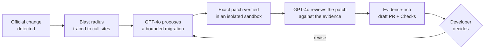
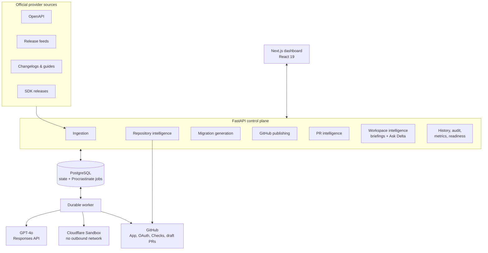

<p align="center">
  
</p>

<h1 align="center">Delta Code</h1>

<p align="center">
  <strong>The AI review bot for breaking API changes.</strong>
</p>

<p align="center">
  Delta Code watches official API and SDK changes, traces them to the exact
  lines they break in your repositories, writes the migration, proves it in an
  isolated sandbox, and opens an evidence-rich draft pull request. It also
  reviews your team's own pull requests and answers questions about your
  repositories, with every claim cited.
</p>

<p align="center">
  <a href="https://deltacode-tau.vercel.app/"><strong>Explore Delta Code</strong></a>
  ·
  <a href="docs/architecture/phase-0-rfc.md">Product RFC</a>
  ·
  <a href="docs/architecture/README.md">Architecture</a>
  ·
  <a href="docs/LOCAL_DEVELOPMENT.md">Run locally</a>
</p>

<p align="center">
  
  
  
  
  
  
  
</p>

---

## Dependabot finds version bumps. Delta Code ships API migrations.

Every external API you depend on changes on its own schedule. Endpoints get
deprecated, fields get renamed, SDK methods change signature. The news shows up
as OpenAPI revisions, release feeds, changelogs, and migration guides, all in
different formats. None of them says which lines of *your* code will break.

So migrations get discovered late, usually in production, and someone has to
work out the impact by hand across every repository.

Delta Code automates that whole loop and keeps a developer in charge of the
final decision:



It isn't a general-purpose coding agent. Every proposed change stays attached
to its authoritative source, the affected call sites, the verification
results, the full attempt history, and whatever uncertainty is left. Nothing
gets merged automatically.

## One platform, three intelligence surfaces

| Surface | What it does for you |
| --- | --- |
| **Migration autopilot** | Turns an upstream API or SDK change into a verified, repository-specific draft pull request. |
| **AI pull request reviewer** | Gives any open pull request a structured risk overview: a verdict, risk signals, test gaps, and specific reviewer questions. |
| **Workspace intelligence** | Writes portfolio briefings and runs *Ask Delta*, a chat that reads your repository source and cites the exact files it used. |

All three run through the same bounded, schema-validated model client and the
same cost controls, and all three keep their results in a searchable history.

---

## 1. Migration autopilot

### Watch authoritative sources

Collectors capture OpenAPI documents, structured JSON releases, official JSON
feeds, changelogs, migration guides, and SDK releases. Only domains configured
as official for a provider are accepted. Every capture is content-addressed,
deduplicated, and normalized into a provider-independent
[change contract](docs/architecture/schemas/normalized-change.schema.json)
with full provenance. A per-source health view shows which feeds are healthy,
degraded, failing, or never synced. The worker sweeps every enabled source hourly, and a
repeated tick cannot queue a second sync.

### Trace the blast radius

Each normalized change fans out across every connected repository. Delta Code
snapshots the selected commit and inventories PyPI and npm dependencies from
`requirements*.txt`, `pyproject.toml`, `package.json`, and `package-lock.json`, checking
version specifiers against the affected range. It then locates call sites:

- **Python:** semantic AST analysis that resolves imports, aliases, and dotted
  attribute chains (for example, `client.send` traces back to
  `example_sdk.Client.send`).
- **JavaScript / TypeScript:** conservative lexical evidence for symbols,
  endpoints, and request fields, with its limitations reported openly.

Each repository gets an explicit outcome (*affected*, *unaffected*,
*uncertain*, or *unsupported*) with confidence and a basis for it. Only
affected repositories move on to migration.

### Generate a repository-specific fix

GPT-4o gets a bounded context: provider evidence, an immutable repository
snapshot, the known call-site identifiers, and any revision notes from the
developer. It returns a minimal plan, structured file edits, test changes, and
the exact verification commands to run, all as strict JSON. Anything it can't
determine stays marked as unknown rather than guessed.

### Verify before anyone reviews it

A trusted worker validates the structured edits against patch policy (content
hashes, path rules, size budgets). The edits then run in a separate
**Cloudflare Sandbox** with outbound network access denied. Build, lint,
type-check, and test results, logs with secrets redacted, and resource costs
are stored as immutable
[migration evidence](docs/architecture/schemas/migration-evidence.schema.json).
GPT-4o then reviews the finished patch against that evidence and recommends
**approve**, **revise**, **snooze**, or **decline**, with findings tied to the
evidence.

### Open the review where developers already work

Delta Code builds Git trees and commits from the exact verified patch, pushes
an owned branch, opens a draft pull request whose body carries the base commit
SHA, the patch SHA-256, and the evidence, and publishes GitHub Check Runs.
Publication stops if the base branch has moved since verification or the
remote branch has been changed by someone else.

### Keep the human decision explicit

The migration inbox supports approve, revise, snooze, decline, retry, and
publish. A revision creates a new immutable attempt; earlier attempts are
never overwritten, so the full reasoning trail stays available for review.

---

## 2. AI pull request reviewer

The **Pull requests** view lists recent pull requests from up to 50 connected
repositories. GitHub is queried in parallel and no model is called for the
list. When a developer clicks **Generate**, Delta Code sends a bounded
snapshot (up to 100 files and 60k characters of diff, plus checks, commits, and
discussion) and gets back a structured overview:

- **Verdict:** `low_risk`, `review_needed`, `high_risk`, or
  `insufficient_context`
- **Executive summary** and a list of what changed
- **Risk signals** with severity and supporting evidence
- **Review focus areas**, each tied to a file path and a specific question for
  the reviewer
- **Test assessment** (`adequate`, `gaps`, or `unknown`) listing the missing
  coverage
- **Recommended actions** and a **confidence score with its basis**. Truncated
  or missing context lowers confidence.

The reviewer is told not to call code safe, tested, or merge-ready unless the
snapshot shows it. Every overview is saved as a versioned attempt with its
head SHA, model, token usage, and cost, so you can compare reviews of the same
pull request over time.

## 3. Workspace intelligence

### Repository briefings

Pick up to 20 repositories and a mode (**readiness**, **repository health**,
or **migration portfolio**). Delta Code produces a briefing with a headline,
an executive summary, ranked priorities with urgency and a recommended action
(`connect`, `scan`, `review`, `generate`, `revise`, `publish`, `monitor`),
portfolio-level risks, and next steps. Each item links back to the evidence it
is based on. Briefings are cached by a digest of the underlying workspace
state and report token usage and cost for every generation.

### Ask Delta

A threaded chat scoped to up to three repositories you select. Ask Delta pulls
the most relevant source files through the GitHub App, within a strict budget
of 10 files per repository and 56k characters in total. It always skips
`.env`, credential, and secret files. It combines that source with your
workspace's migrations, providers, and pull requests. Every answer comes with:

- citations to dashboard pages (repositories, providers, migrations, pull
  requests),
- citations to the repository source paths it used, with the reason each was
  relevant,
- an explicit `out_of_scope` or `insufficient_context` status when it can't
  answer from the evidence,
- suggested follow-up questions.

### Intelligence history

Every chat thread, briefing, and pull request overview is kept in one
searchable, filterable, paginated history. You can go back to earlier answers
and compare generations without paying for the same work again.

---

## AI proposes. Evidence proves. You decide.

The model never decides whether a check passed. Delta Code keeps a hard
boundary between what the model interprets and what deterministic systems
establish:

| GPT-4o interprets and proposes | Deterministic systems establish |
| --- | --- |
| Provider prose and migration intent | Captured source artifacts and content hashes |
| Repository-specific migration plans | Dependency inventory and call-site evidence |
| Bounded code and test edits | Patch policy and file integrity |
| Evidence-grounded review findings | Build, lint, type-check, test, and behavior results |
| Pull request risk overviews and briefings | Git objects, draft PR state, Check Runs |
| Developer-facing explanations | Lifecycle transitions and the audit log |

## Security and safety controls

Delta Code runs model-written code against untrusted repositories, so it is
built with several independent safety layers:

**Model boundary**
- Strict JSON-schema structured output. The model gets no tools and no
  browsing, and requests are sent with `store: false`.
- Repository files, provider text, pull request discussion, and developer
  notes are treated as untrusted data, never as instructions.
- Input and output limits are enforced (120 KB input by default, 5 MB response
  ceiling), with limited retries.
- **Cost controls for the whole process:** a per-request cap ($0.20 by
  default) plus daily and total spend limits for each process, which reserve
  budget before a call is made.

**Sandbox boundary**
- Commands run in a separate Cloudflare Sandbox Worker with no outbound
  network access, and hosted execution stays off until it is explicitly
  enabled.
- Only allowlisted executables can run (`python`, `pytest`, `ruff`, `mypy`,
  `pyright`, `node`, `npm`, `pnpm`, `yarn`, `bun`, `go`, `cargo`, and a few
  others), within limits on edits, checks, timeouts, and log size.
- Edits to `.git`, `.github/workflows`, CI configuration, `.ssh`, `.aws`,
  `.env`, `.npmrc`, private keys, and credential files are rejected.
- Logs are scrubbed of private keys, GitHub tokens, API keys, and
  `secret=`/`password=` style values before they are stored.

**Ingestion and GitHub boundary**
- Source URLs must belong to a configured official domain. Hosts that resolve
  to private, loopback, reserved, or cloud-metadata addresses are blocked
  (SSRF protection).
- Repository access comes from the GitHub App installation. Dashboard sign-in
  uses a separate GitHub OAuth flow, and all data is scoped to repositories
  the signed-in user can access.
- Write requests check the request origin, and publishing refuses to write if
  the base branch or remote head has changed since verification.

See [Security and permissions](docs/architecture/security-and-permissions.md)
for the full threat model.

## Architecture



The web service handles authenticated APIs. A separate Procrastinate worker
runs every long job: ingestion, repository analysis, generation, publication,
briefings, chat, and pull request reviews. Each job is tracked with
Prometheus metrics using a fixed set of labels.

## Built to production standards

- **10 authenticated API domains** with versioned Pydantic contracts,
  lifecycle transitions protected by optimistic concurrency, idempotent
  writes, and a full audit trail.
- **7 durable job types** on PostgreSQL-backed Procrastinate, reporting
  completed, failed, and skipped counts and durations.
- **Operational endpoints:** `/health`, `/ready`, and Prometheus-format
  `/metrics`.
- **Analyzer release gate:** a labeled benchmark of affected, unaffected,
  uncertain, and unsupported cases across Python, TypeScript, JavaScript, and
  npm (`make benchmark`).
- **Real-migration backtest:** on 50 held-out migrations from public repositories,
  impact analysis found 95.5% of the lines developers actually changed. See
  [measured performance](docs/PERFORMANCE.md), including what has not been measured yet.
- **Contract fixtures:** JSON schemas and example payloads for normalized
  changes and migration evidence, checked by the test suite.
- **CI on every pull request:** Ruff and pytest for the backend, ESLint plus a
  build that checks every rendered route for the frontend, and typed policy
  tests for the sandbox worker.
- **Deployment:** Railway (web and worker services), Vercel (dashboard), and
  Cloudflare (sandbox).

## Quick start

```bash
make setup        # backend venv, frontend, and sandbox dependencies
make db-up        # local PostgreSQL via Docker
make db-schema    # apply the Procrastinate schema
make api          # FastAPI on :8000
make worker       # durable background worker
make frontend-dev # Next.js dashboard on :3000
make test         # lint, backend, frontend, sandbox, and benchmark
```

Without an API URL, the dashboard runs on clearly labeled preview data. Set
`OPENAI_API_KEY` on the backend to turn on the intelligence features. See
[Local development](docs/LOCAL_DEVELOPMENT.md) for GitHub App, OAuth, and
sandbox configuration.

## Current scope

The current release is deliberately conservative. It reports uncertainty
openly instead of making confident guesses:

- Python has the most complete semantic impact coverage. JavaScript and
  TypeScript analysis reports positive lexical evidence and lists its
  limitations.
- Generated migrations only touch the supplied files and known call sites.
- Sandbox verification requires an explicitly configured executor.
- Draft pull requests stay under developer control and are never merged
  automatically.
- AI pull request overviews are advisory and do not approve anything.

## Technology

| Area | Technology |
| --- | --- |
| API and control plane | FastAPI, Pydantic |
| Persistence and background work | PostgreSQL, Procrastinate |
| Intelligence | GPT-4o via the OpenAI Responses API (strict structured output) |
| Sandboxed verification | Cloudflare Sandbox Worker (TypeScript) |
| GitHub integration | GitHub App, OAuth, Git Data API, Check Runs, draft PRs |
| Dashboard | Next.js, React 19, TypeScript, custom CSS (light and dark themes) |
| Hosting | Railway, Vercel, Cloudflare |

## Documentation

- [Measured performance](docs/PERFORMANCE.md)
- [Product RFC](docs/architecture/phase-0-rfc.md)
- [Architecture overview](docs/architecture/README.md)
- [Domain model](docs/architecture/domain-model.md)
- [System contracts](docs/architecture/contracts.md)
- [Security and permissions](docs/architecture/security-and-permissions.md)
- [Control plane](docs/architecture/phase-1-control-plane.md)
- [Source ingestion](docs/architecture/phase-2-ingestion.md)
- [Repository intelligence](docs/architecture/phase-3-repository-intelligence.md)
- [AI generation and sandbox verification](docs/architecture/phase-4-generation-and-sandbox.md)
- [GitHub publishing](docs/architecture/phase-5-github-publishing.md)
- [Migration inbox](docs/architecture/phase-6-migration-inbox.md)
- [Generalization and hardening](docs/architecture/phase-7-generalization-and-hardening.md)
- [Frontend](frontend/README.md) · [Design system](DESIGN.md)
- [Local development](docs/LOCAL_DEVELOPMENT.md)

---

<p align="center">
  <br>
  <strong>Delta Code</strong><br>
  AI proposes. Evidence proves. You decide.
</p>
